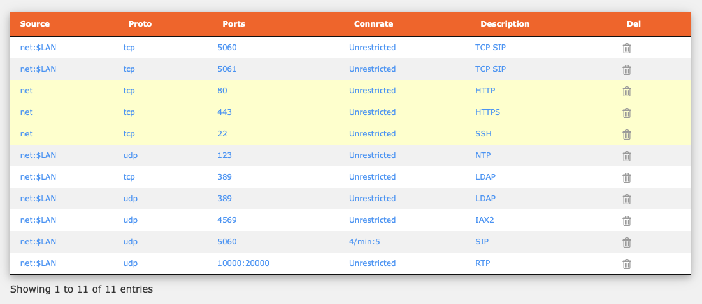

#Firewall

The SARKV65 firewall uses the Shorewall firewall.    

Below is a screenshot of the firewall from a newly installed system.  

**N.B.** ports 80, 443 and 22 are initially set open to anywhere.  This is so you don't accidentally lock yourself out before you begin.   You MUST restrict these to a sensible set of values before you go live with the system.   Usually, as a first step, *net:$LAN* (see below) might be sufficient.  Obviously, if you are accessing the system from outside the LAN then you'll need to handle that too.

Any cell rendered in blue can be inline edited by clicking on it and modifying the contents.  Once done, press return or click anywhere outside the edit box.

Create a new rule by clicking the *+Add* button at the top of the screen.

##Source

A Source entry will always begin with *net*.   If you type nothing else than the rule will be worldwide accessible (so be careful with it).   To narrow the permission, follow *net* with a colon (net:) and then a source.  The source can be specified in CIDR format or as an absolute IP address.

So, if you wanted to restrict access to a rule from IP address 5.5.5.5 (and ONLY 5.5.5.5), then you could code 

*net:5.5.5.5*

 or 
 
 *net:5.5.5.5/32*, which is the same thing.

There is a special value,  *$LAN*, which allows access from your local subnet (e.g. 192.168.0.0/16, 172.16.0.0/12, 10.0.0.0/8 etc.).  The actual subnet is harvested by SARK when it initializes.

*net:$LAN*

##Protocol

This is a dropdown which can either *udp* or *tcp*

##Ports

This can be a single port, mutiple ports (separated by commas) and/or a port range (separated by a colon).  So, for example to handle SIP/RTP UDP you might code 

*5060,10000:20000*   

This would handle both SIP (5060) and RTP range (10000:20000)

##Rate

This controls the connection rate of an endpoint.  It is specified as the maximum number of allowed connections per time unit.   So, the rule *4/min:5*, in the default SIP (5060) rule, allows a burst of 5 connections per source IP and 4 connections per minute.  You can find full details of this in the Shorewall docs.

##Description

This is a freeform description string which you can include next to the rule.   Use plain language without special characters, e.g. SIP from the London Office 

##Apply your changes

Hit the *Restart Firewall* button at the top of the page.   This will give you a report on how well your changes went.   Any errors will be flagged and the firewall will not be restarted.  Go back to the firewall page and correct any errors. 